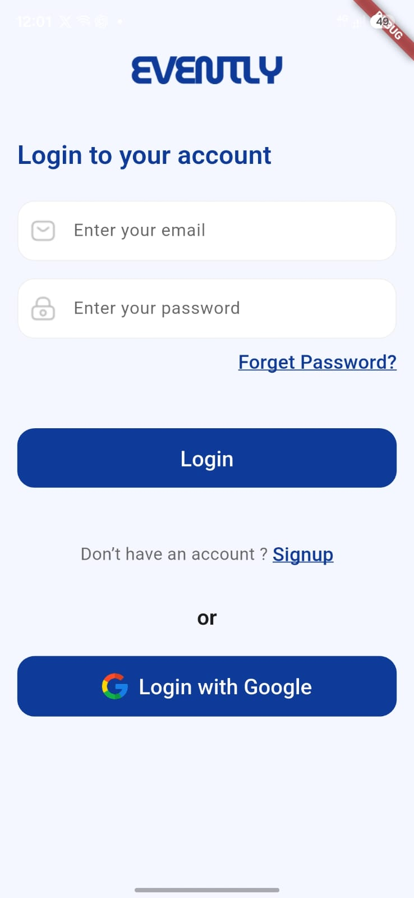
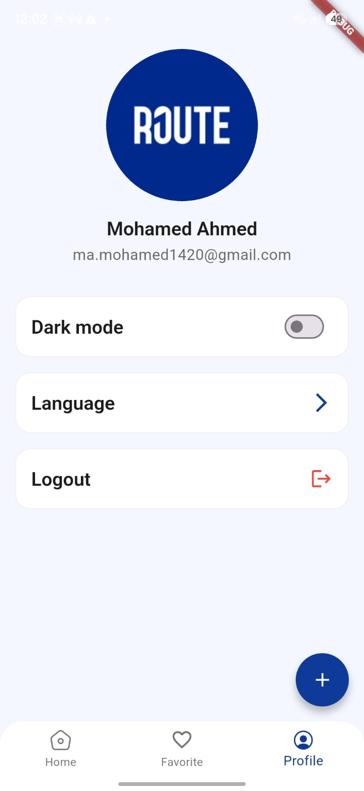
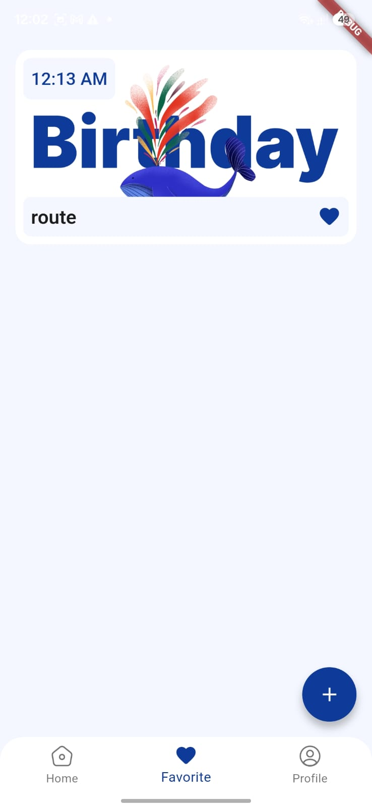

# 🎉 Evently – Event Management App

A modern and user-friendly event management mobile application built with Flutter and Firebase. Evently allows users to create, manage, explore, and save their favorite events through a clean and intuitive interface.

## 📱 App Screenshots

### 🔐 Authentication

| Login | Create Account |
|:---:|:---:|
|  |  |

| Forgot Password | Profile |
|:---:|:---:|
|  |  |

### 🎟️ Event Management

| Home Screen | Event Details |
|:---:|:---:|
|  |  |

| Add Event | Edit Event |
|:---:|:---:|
|  |  |

### ❤️ Favorites



---

## ✨ Features

- User Registration and Login.
- Password Recovery.
- Browse and Explore Events.
- View Detailed Event Information.
- Create New Events.
- Edit Existing Events.
- Add Events to Favorites.
- Manage User Profile.
- Dynamic Event Management.
- Firebase Backend Integration.

## 🛠️ Technologies & Tools

| Technology | Usage |
|---|---|
| Flutter | Cross-platform UI development |
| Dart | Programming Language |
| Provider | State Management |
| Firebase Authentication | User Authentication |
| Cloud Firestore | Cloud Database |
| REST APIs | API Integration (where applicable) |
| Git & GitHub | Version Control |

## 🏗️ Architecture & Development

- Organized and reusable Flutter widgets.
- Provider-based state management.
- Separation of UI and application logic.
- Firebase integration for backend services.
- Responsive and user-friendly interfaces.

## 🚀 Getting Started

### Prerequisites

- Flutter SDK
- Dart SDK
- Android Studio or VS Code
- Firebase Account

### Installation

1. Clone the repository:

```bash
git clone https://github.com/MohamedAhmed1420/Evently.git
```

2. Navigate to the project directory:

```bash
cd Evently
```

3. Install dependencies:

```bash
flutter pub get
```

4. Configure Firebase:

- Create a Firebase project.
- Register your Android application.
- Configure Firebase Authentication.
- Set up Cloud Firestore.
- Configure FlutterFire if needed.

5. Run the application:

```bash
flutter run
```

## 👨‍💻 Developer

**Mohamed Ahmed Ibrahim**

Mobile Application Developer | Flutter & Native Android

- GitHub: [MohamedAhmed1420](https://github.com/MohamedAhmed1420)
- Project: [Evently Repository](https://github.com/MohamedAhmed1420/Evently)

---

*Built with Flutter and ❤️ by Mohamed Ahmed Ibrahim.*